# PipeBoard

A calm node board for routing PipeWire audio, with effects built in.

The `qpwgraph` PipeWire GUI is cool and all, but I don't like how cluttered, unreadable, hard to navigate, and limiting it is.
I also used to use `EasyEffects` for a bass boost EQ for my headphones, but I found it limiting (at times even unstable) too.
Frustrated, I decided to build my own: route your audio easily, and add gain, EQ, dynamics or your own
plugins to any signal path.

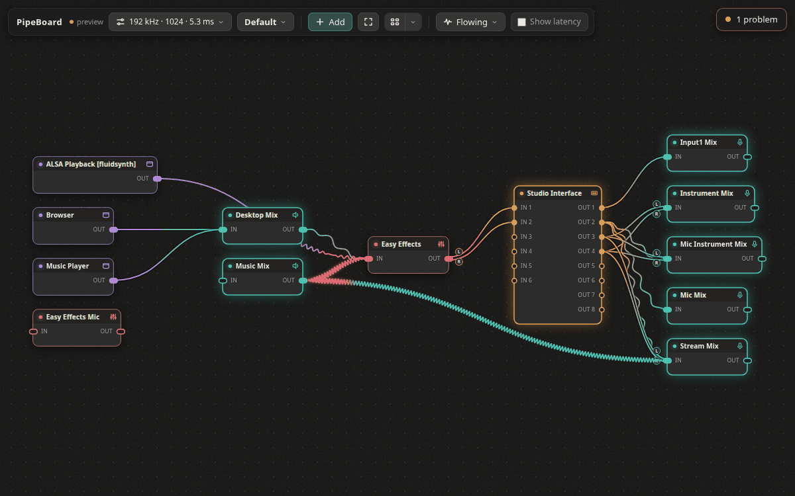

## What it does

- **Route anything:** apps, virtual mixes, sound cards and USB devices are cards; drag a wire from
  an output to an input. Stereo, mono and single channels are handled for you.
- **Effects on any path:** Gain, an EQ with dynamic bands, Limiter, Compressor, Noise Gate,
  De-Esser and Noise Suppression, plus your own LV2 and VST3 plugins.
- **See the sound:** each wire carries a moving picture of its sound: broad waves for a kick drum,
  fine ripples for a hi-hat, glowing red where it clips. Every effect has a live panel too.
- **Virtual devices:** make microphones and speakers that apps can use.
- **Profiles:** save a routing; before loading one, see what it will change.
- **Problems, explained:** feedback loops, failed connections and one-sided stereo are listed,
  worst first.
- **Diagnostics:** wire any output into a Waveform, Stereo imager, Meter, Spectrum or Counter to
  see and measure what it carries, without touching the sound.

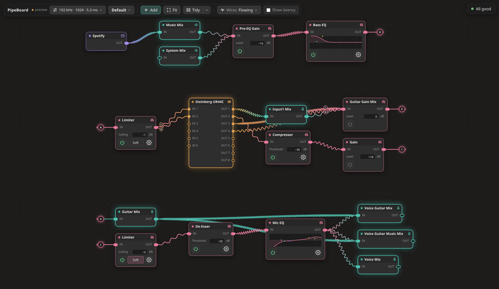

## Portals

Long boards fold into rows with **Tidy**. A wire between rows becomes a pair of lettered portals,
so it doesn't cross the whole board. The arrow on each badge shows which way the sound goes.

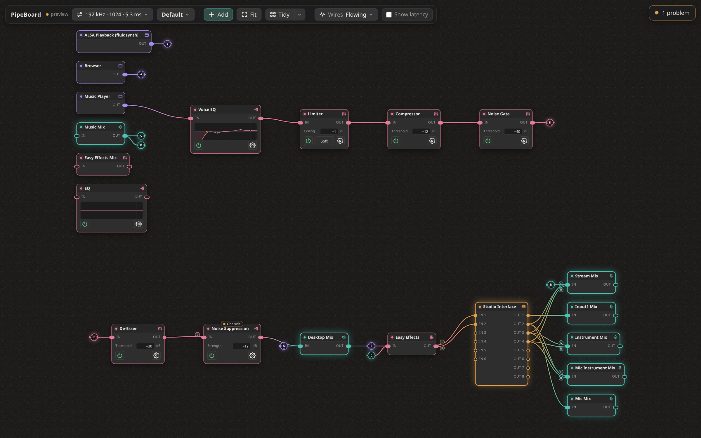

Hover a portal, or either card, to see its whole wire. Right-click any wire to make it a portal
yourself. Folding is off until you turn on **Portals** in Tidy's menu (the arrow next to it). Portals only change the drawing; the
sound still goes straight from A to B.

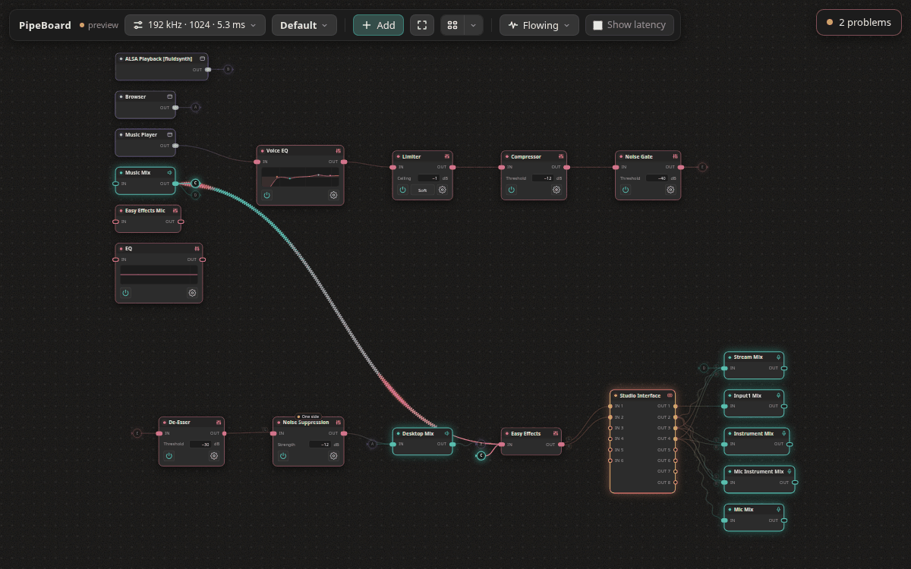

## Effects

| EQ with dynamic bands | Limiter |
|---|---|
| 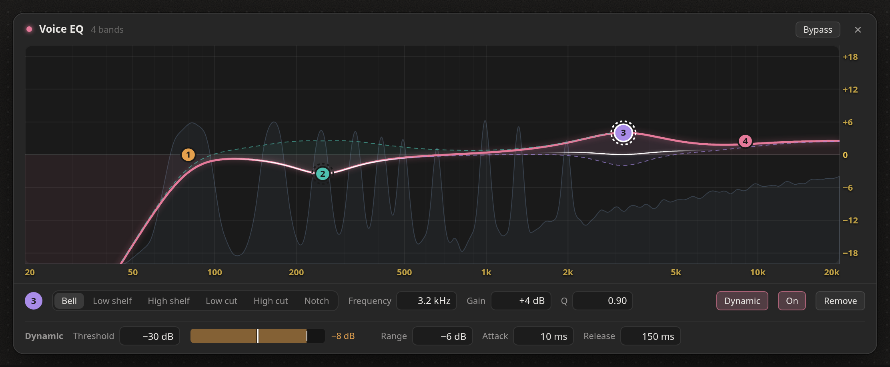 | 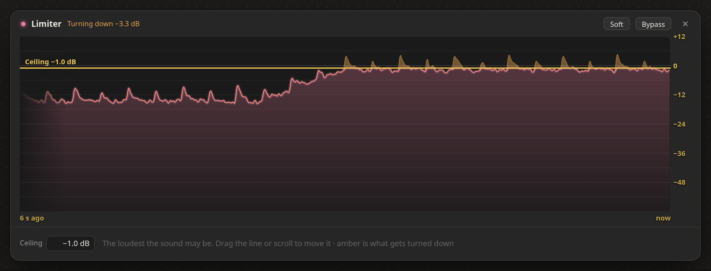 |
| **Compressor** | **Noise Gate** |
| 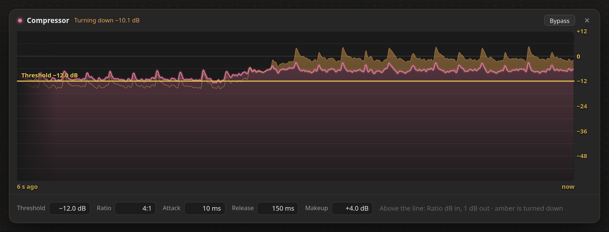 | 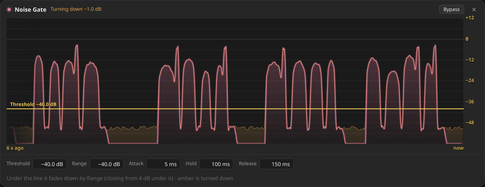 |
| **De-Esser** | **Noise Suppression** |
| 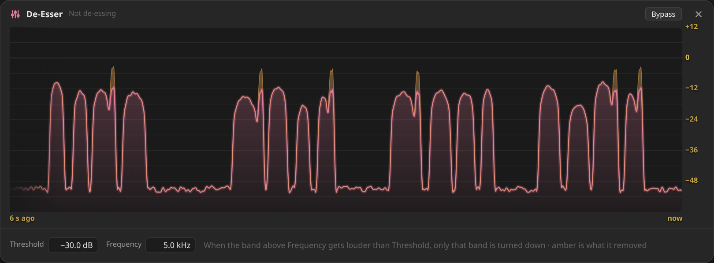 | 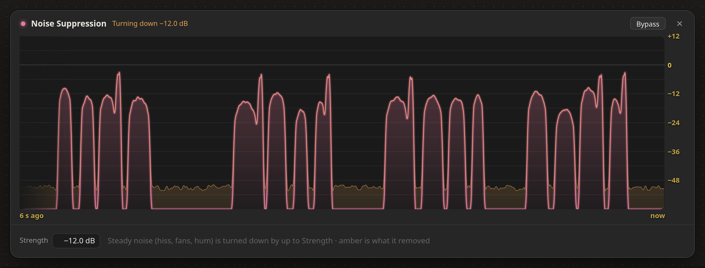 |

Amber is what an effect turned down. Every effect card has a power button (bypass) and a gear
that opens its panel.

## Latency and the audio engine

Tick **Show latency** to see what each effect adds and the total delay arriving at each device.
Click a total to see where it comes from: every step on the way, the delay of each, and whether
anything dropped out while the panel was open.

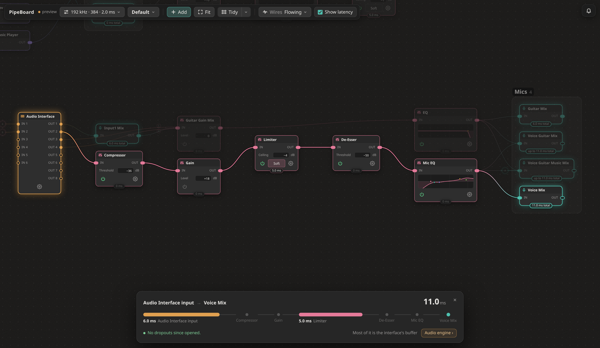

The clock readout in the bar opens the **Audio engine**: the block size and the interface's safety
margin, with the round trip they make, and under Advanced the scheduling (interrupts or timer),
the CPU's deep idle states, the low-latency kernel options, and PipeWire's priorities. A change is tried for a minute and goes
back by itself unless you keep it.

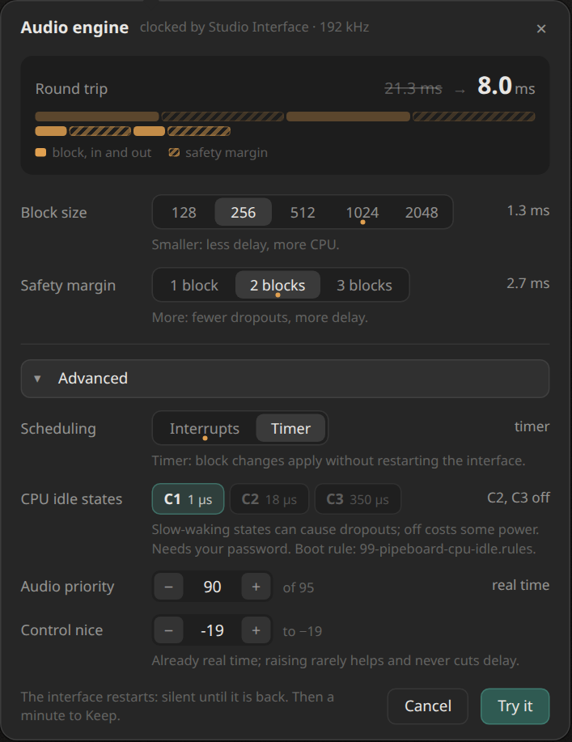

## Diagnostics

Add › Diagnostic. These cards only listen: wire any output into one beside its usual path and
PipeWire copies the sound there, so nothing you hear changes. They draw only while the window is
showing, the power button switches one off completely, and clicking the picture opens it large.

[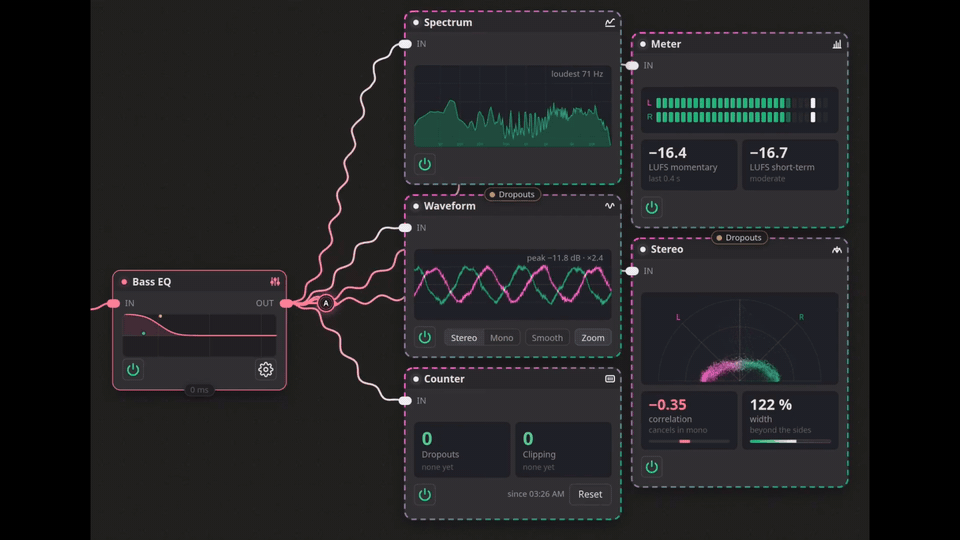](docs/images/diag.mp4)

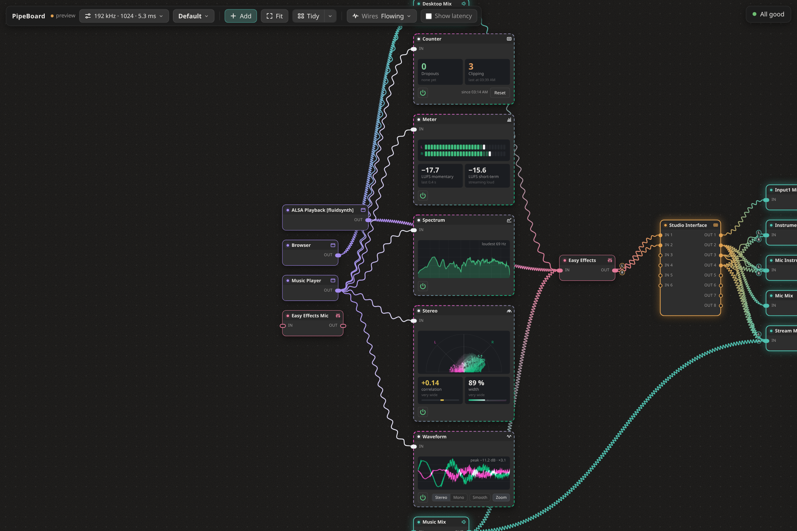

| Waveform | Stereo |
|---|---|
| 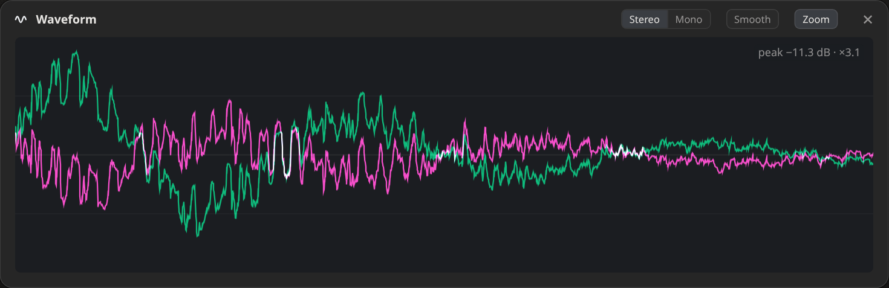 | 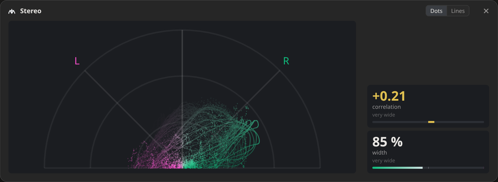 |
| **Meter** | **Spectrum** |
| 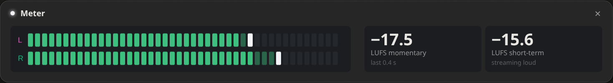 | 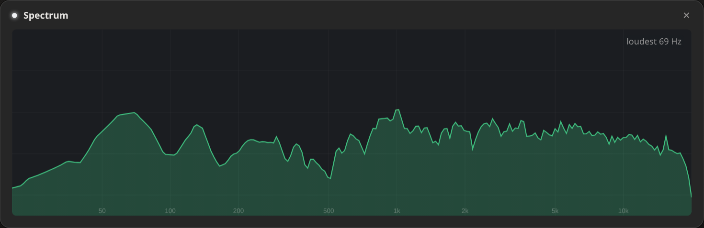 |

- **Waveform:** the live L and R traces, held steady. Mono combines them, Smooth leaves out the
  sharpest detail, Zoom fits a quiet sound to the box.
- **Stereo:** every sample a dot. Mono is a vertical line, wide stereo fans out, and sound lying
  flat cancels when played in mono. **Correlation** says how alike L and R are (+1 mono, below 0
  cancels in mono); **width** how far the picture fans out (100 % reaches the L and R lines).
- **Meter:** L and R levels with peak hold, and loudness in LUFS, the way streaming platforms
  measure it (they play music at about −14).
- **Spectrum:** which frequencies the sound has, from 20 Hz to 20 kHz.
- **Counter:** dropouts and clipping on the way to it since you last pressed Reset, with when the
  last one happened. Dropouts are counted even while the window is closed.

## Install

```sh
curl -fsSL https://raw.githubusercontent.com/TominoCZ/PipeBoard/main/install.sh | bash
```

Or from a clone: `./install.sh`. It checks what your system needs, offers the install command for
your distribution (it only uses sudo if you say yes), adds a `pipeboard` command and an
app-menu entry, and starts PipeBoard at login, in the tray (turn that off in the tray menu). Run it
again to update; `install.sh --uninstall` removes it. Everything it may ask
for is in [`docs/deps.md`](docs/deps.md).

Built for Linux with PipeWire and WirePlumber; the tray and window are made for KDE Plasma. It is
young software, so expect rough edges.

## Using it

- **Connect:** drag from an OUT socket to an IN socket. **Disconnect:** click a wire, then Delete;
  or right-click a card › Disconnect to unplug it completely.
- **Add:** right-click the board › Add node (effects, devices, apps). Drop a wire on empty board to
  add something already connected.
- **Numbers:** scroll or type, Enter applies, Esc cancels.
- **Move around:** drag to pan, scroll to zoom, **F** to fit, **Tidy** to lay out by signal flow
  (see [Portals](#portals)). **Wires** sets how they show the sound: still, flowing, or instant.
- **Tray:** closing the window keeps PipeBoard running. Launch at login is in the tray menu.

Your board is saved in `~/.config/pipeboard/`. The full design is in [`docs/PLAN.md`](docs/PLAN.md).

## Develop

```sh
./run.sh --fixture pedal   # a saved graph to click through; never touches PipeWire
./run.sh shots             # render every UI state to .dev/shots/ and audit the layout
./run.sh check             # the checks
```

## License

MIT, see [LICENSE](LICENSE).
